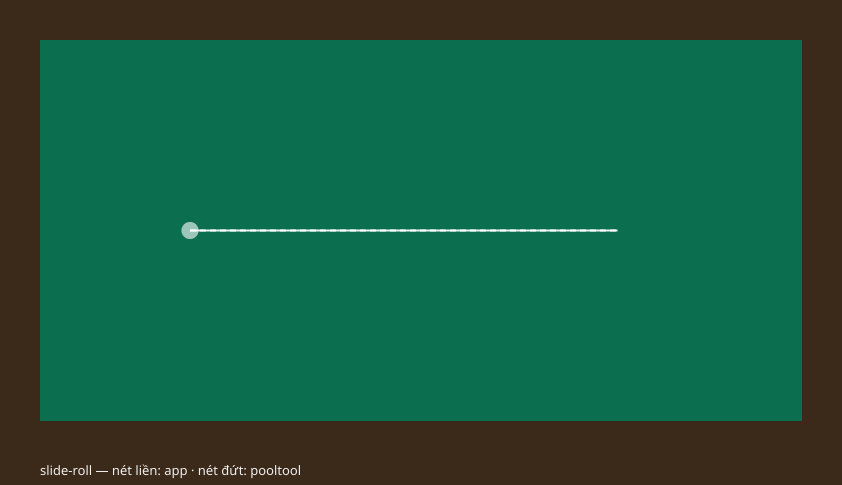
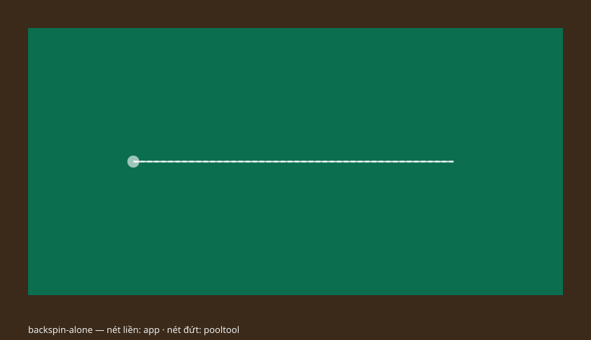
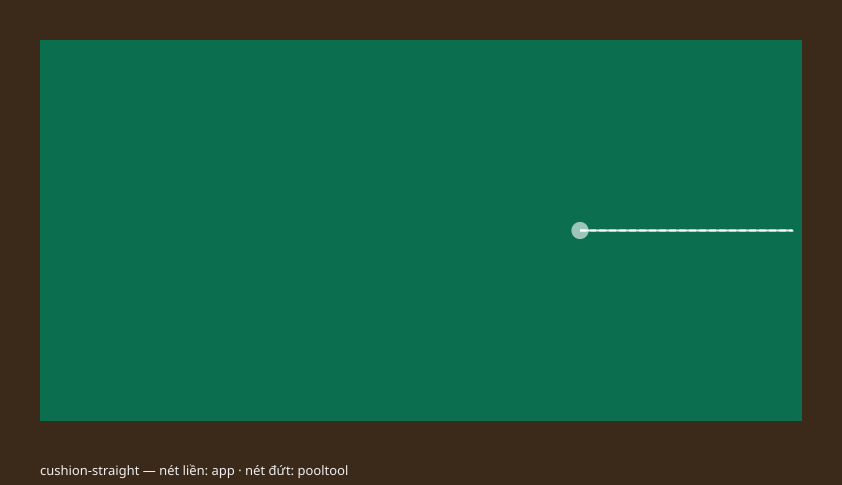
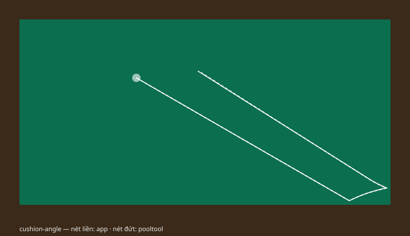
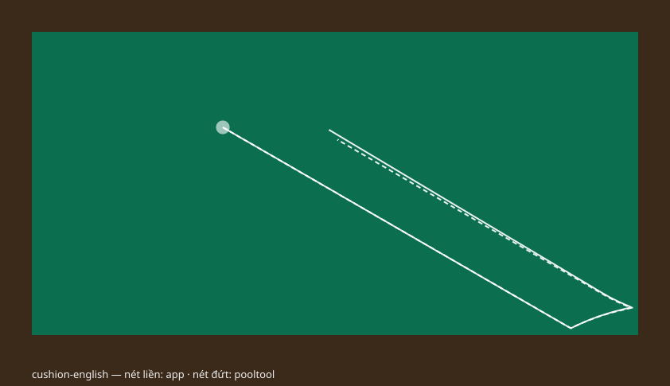
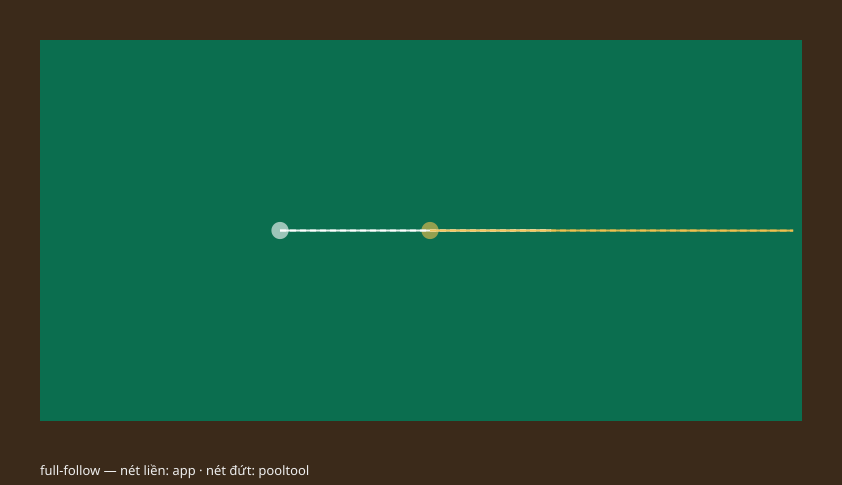
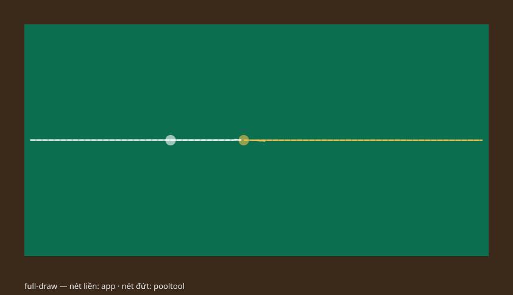
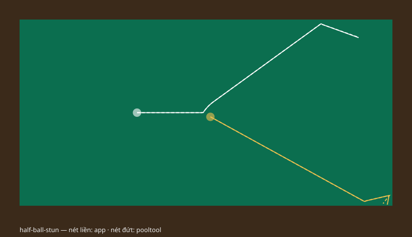
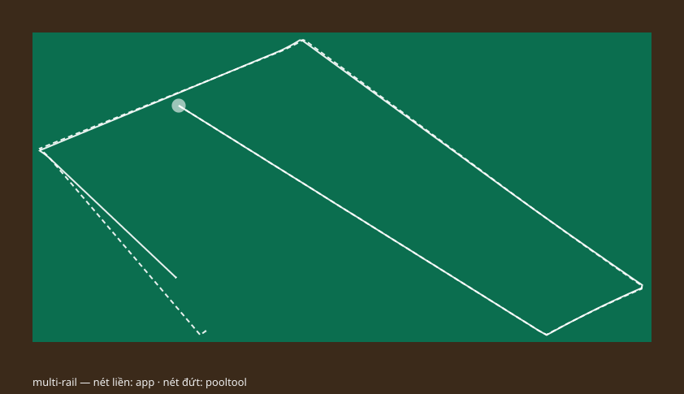

# So sánh engine: app vs pooltool

Sinh bởi `scripts/engine-compare/compare.mjs` — pooltool 0.6.0 (mô hình băng: han), bàn `club-9ft` (2540×1270 mm).
Cả hai engine nhận **cùng trạng thái ban đầu của bi cái** (vận tốc + xoáy), không qua mô hình cơ, nên chênh lệch chỉ đến từ vật lý bàn / băng / va chạm.
Thông số pooltool được đặt theo profile bàn của app (xem `run-pooltool.py`). Hình học lỗ hai bên khác nhau.

| Cú đánh | Bi | Lệch cuối (mm) | Lệch max (mm) | RMS (mm) | Thời gian app / pt (s) | Số lần chạm băng app / pt | Va chạm bi đầu app / pt (s) | Rơi lỗ app / pt |
|---|---|---|---|---|---|---|---|---|
| slide-roll | 0 | 0 | 9 | 4 | 3.77 / 3.79 | 0 / 0 | – / – | [] / [] |
| backspin-alone | 0 | 0 | 14 | 4 | 3.69 / 3.71 | 0 / 0 | – / – | [] / [] |
| cushion-straight | 0 | 11 | 14 | 8 | 3.21 / 3.20 | 1 / 1 | – / – | [] / [] |
| cushion-angle | 0 | 27 | 27 | 17 | 4.97 / 4.96 | 2 / 2 | – / – | [] / [] |
| cushion-english | 0 | 54 | 54 | 31 | 4.91 / 4.86 | 2 / 2 | – / – | [] / [] |
| full-follow | 0 | 2 | 15 | 4 | 3.58 / 3.58 | 1 / 1 | 0.300 / 0.301 | [] / [] |
| full-follow | 1 | 5 | 14 | 6 | 3.58 / 3.58 | 1 / 1 | 0.300 / 0.301 | [] / [] |
| full-draw | 0 | 7 | 24 | 8 | 4.20 / 4.23 | 2 / 2 | 0.145 / 0.145 | [] / [] |
| full-draw | 1 | 2 | 21 | 10 | 4.20 / 4.23 | 2 / 2 | 0.145 / 0.145 | [] / [] |
| half-ball-stun | 0 | 4 | 19 | 5 | 3.51 / 3.52 | 3 / 4 | 0.257 / 0.258 | [] / [] |
| half-ball-stun | 1 | 27 | 30 | 16 | 3.51 / 3.52 | 3 / 4 | 0.257 / 0.258 | [] / [] |
| multi-rail | 0 | 249 | 271 | 135 | 5.61 / 5.74 | 4 / 5 | – / – | [] / [] |

Kiểm tra dịch chuyển tức thời: không có (ngưỡng 12000 mm/s).

## Hình quỹ đạo

### slide-roll — Stun, ball alone: slide -> roll -> stop

### backspin-alone — Backspin, ball alone

### cushion-straight — Stun straight into the right cushion

### cushion-angle — Rolling ball, 30 deg into the long cushion, no english

### cushion-english — Same as cushion-angle with english

### full-follow — Full hit, natural roll (follow)

### full-draw — Full hit, heavy backspin (draw)

### half-ball-stun — Half-ball cut, stun (30 deg rule / throw)

### multi-rail — Hard shot around several rails with english

